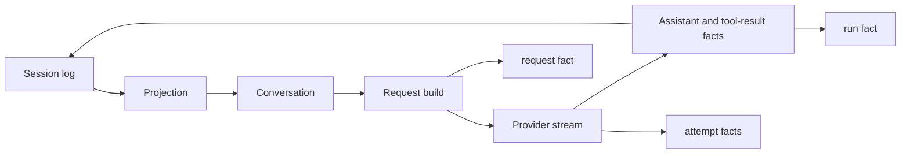

# Event model

A session is a tree of entries, not a message array. Entry types fall into two
groups.

## Model-visible facts

These entries project into the conversation:

| Type | Meaning |
| --- | --- |
| `system` | Base system prompt; the latest one wins |
| `user` | User task or steering input |
| `assistant` | Text and tool calls produced by one model response |
| `tool_result` | Result paired to a tool call |
| `compaction` | Summary plus `first_kept_id`; shadows older entries |
| `window` | New context start plus optional handoff |

`compaction` and `window` also carry projections of their own: a summary
message. The original entries remain readable by the history tool.

## Audit facts

These entries never project:

| Type | Meaning |
| --- | --- |
| `meta` | Session creation metadata |
| `request` | Provider, model, context, digests, estimated tokens, dropped evidence |
| `attempt` | One provider attempt, including failures and retries |
| `run` | Termination, steps, usage, error |

Audit facts make the request reproducible without turning diagnostics into
conversation. A failed run therefore cannot fabricate an assistant message.

## Flow

The loop appends the user fact before the first request. Each step appends one
assistant fact and zero or more tool-result facts. A run appends exactly one
`run` fact.

## Ordering and pairing

A tool result follows its assistant tool call. Projection rejects an orphan
result or a duplicate result. If the branch ends after a tool call without a
result, projection inserts a synthetic interrupted result at the tail so the
request remains protocol-valid.

## Compaction and windows

A compaction cuts at a user boundary. Its summary message appears first in the
retained context. A window discards earlier entries and may insert a handoff.
Only the latest cut applies. Compaction is preferred; a window is a fallback
when a summary cannot fit.

## Schema authority

The closed schema is in [Session log schema](../../cade-mini-schema.md). The
generated [event catalog](event-catalog.md) lists the current event types from
code.
