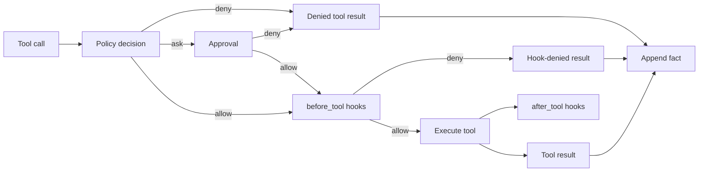

# Tool execution

Every tool call follows the same pipeline. Policy and approval decide whether a
call may run; hooks can stop it; the loop owns execution and recording.

## Order

1. The model returns a tool call with an ID and arguments.
2. Policy checks tool name, path, mode, rules, grants, and shell classification.
3. An `ask` decision is resolved by the host: TTY prompt, `--yes`, auto-review,
   or denial.
4. `before_tool` hooks run. A non-zero exit denies the call.
5. The tool executes with a timeout and cancellation token.
6. The result is truncated, appended as a `tool_result` fact, and rendered.
7. `after_tool` hooks run and their output is ignored.

## Denials and errors

A denied call is not an exception. It becomes an error tool result so the model
can adapt. Unknown tools, malformed arguments, timeouts, and thrown exceptions
also become error results. A cancellation appends interrupted results for any
remaining calls before the run terminates.

## Hooks

Hooks receive the tool name, JSON arguments, and the result for `after_tool`.
They run with the workspace as the current directory. A hook timeout is a
denial or a silently ignored observer, never an unbounded wait.

## Evidence retention

Tool results are facts. Request admission can replace old bodies with a
reference that names the `call_id`. The history tool retrieves the exact result
from the branch, so pruning does not destroy evidence.

## Tests

- `test_mini_loop.py` covers approval, errors, timeouts, cancellation, retries,
  and window fallback.
- `test_mini_hooks.py` covers allow, deny, and after-hook execution.
- `test_mini_policy.py` covers modes, rules, grants, and boundaries.

See [Tools and security](../tools-security.md) for user-facing behavior.
