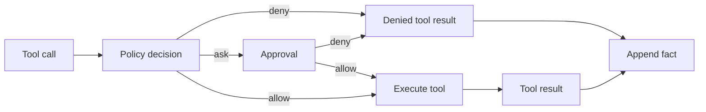

# Tool execution

Every tool call follows the same pipeline. Policy and approval decide whether a
call may run. The shared harness executor owns execution, and the loop records
model-turn results. Direct application calls use the same executor without
inventing conversation facts.

## Order

1. The model returns a tool call with an ID and arguments.
2. Policy checks tool name, path, mode, rules, grants, and shell classification.
3. An `ask` decision is resolved by the host: TTY prompt, `--yes`, auto-review,
   or denial.
4. The tool executes within the approved per-call scope, with a timeout and
   cancellation token. Linux/macOS workspace tools use OS confinement.
5. The result is truncated, appended as a `tool_result` fact, and rendered.
   Its `artifact.authorization` records decision, reason, and scope without
   adding that metadata to the model transcript.

## Denials and errors

A denied call is not an exception. It becomes an error tool result so the model
can adapt. Unknown tools, malformed arguments, timeouts, and thrown exceptions
also become error results. A cancellation appends interrupted results for any
remaining calls before the run terminates.

## Evidence retention

Model-turn tool results are facts. Request admission preserves projected
messages and rejects an over-budget request rather than replacing old bodies.
Compaction and window events explicitly reduce visible history. The history
tool retrieves exact retained facts by `call_id` or entry ID.

## Tests

- `test_loop.py` covers approval, errors, timeouts, cancellation, retries,
  and window fallback.
- `test_policy.py` covers modes, rules, grants, and boundaries.

See [Tools and security](../tools-security.md) for user-facing behavior.
