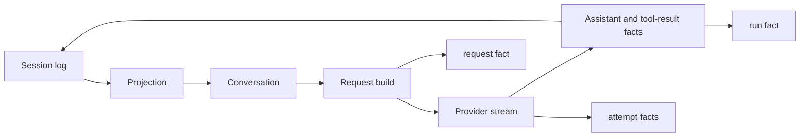

# 事件模型

会话是条目树，不是消息数组。条目类型分为两组。

## 模型可见事实

这些条目会投影进对话：

| 类型 | 含义 |
| --- | --- |
| `system` | 基础系统提示；最新的生效 |
| `user` | 用户任务或引导输入 |
| `assistant` | 一次模型响应产生的文本和工具调用 |
| `tool_result` | 与工具调用配对的结果 |
| `compaction` | 摘要加 `first_kept_id`；遮蔽较早的条目 |
| `window` | 新的上下文起点，可附带交接 |

`compaction` 和 `window` 也携带自己的投影：一条摘要消息。原始条目仍可由 history 工具读取。

## 审计事实

这些条目不会投影：

| 类型 | 含义 |
| --- | --- |
| `meta` | 会话创建元数据 |
| `request` | provider、模型、上下文、摘要哈希、估算 token、被丢弃的证据 |
| `attempt` | 一次 provider 尝试，包括失败和重试 |
| `run` | 终止原因、步骤数、用量、错误 |

审计事实让请求可以复现，同时不把诊断信息变成对话。因此失败的运行不会伪造 assistant 消息。

## 流程

循环在第一次请求之前追加 user 事实。每个步骤追加一条 assistant 事实和零条或多条 tool-result 事实。一次运行恰好追加一条 `run` 事实。

## 顺序与配对

工具结果跟在其 assistant 工具调用之后。投影拒绝孤立结果或重复结果。如果分支在工具调用之后结束且没有结果，投影会在尾部插入一条合成的“已中断”结果，让请求保持协议有效。

## 压缩与窗口

压缩在用户边界切分。摘要消息出现在保留上下文的最前面。window 丢弃较早的条目，可以插入交接。只有最新的切点生效。优先使用压缩；摘要仍放不下时，window 是回退方案。

## 格式权威

封闭格式定义在[会话日志格式](../reference/session-schema.md)。生成的[事件目录](event-catalog.md)列出代码中的当前事件类型。
