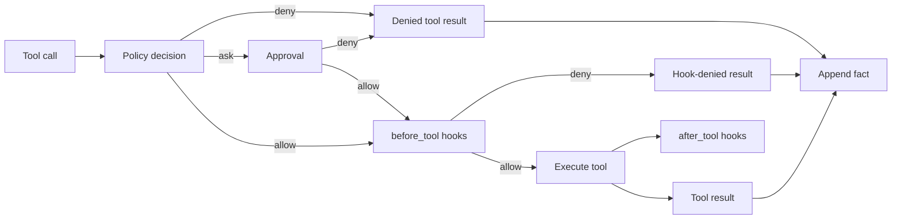

# 工具执行

每次工具调用都走同一条流水线。策略和审批决定调用能否执行；钩子可以阻止；循环负责执行和记录。

## 顺序

1. 模型返回带 ID 和参数的工具调用。
2. 策略检查工具名、路径、模式、规则、授权和 shell 分类。
3. `ask` 决策由宿主解决：TTY 提示、`--yes`、自动复核或拒绝。
4. 运行 `before_tool` 钩子。非零退出会拒绝调用。
5. 工具在批准的本次调用范围内执行，带超时和取消令牌。Linux 和 macOS 的工作区工具使用操作系统隔离。
6. 结果被截断，作为 `tool_result` 事实追加并渲染。它的 `artifact.authorization` 记录决策、原因和范围，但不把这些元数据加入模型对话记录。
7. 运行 `after_tool` 钩子，其输出被忽略。

## 拒绝与错误

被拒绝的调用不是异常。它会变成错误工具结果，模型可以据此调整。未知工具、格式错误的参数、超时和抛出的异常也会变成错误结果。取消时，运行终止之前会为所有剩余调用追加“已中断”结果。

## 钩子

钩子收到工具名和 JSON 参数；`after_tool` 还收到结果。它们以工作区为当前目录运行。钩子超时意味着拒绝，或作为观察者被静默忽略，绝不会无限等待。

## 证据保留

工具结果是事实。请求准入可以用指向 `call_id` 的引用替换旧正文。history 工具从分支读取精确结果，因此裁剪不会毁掉证据。

## 测试

- `test_loop.py` 覆盖审批、错误、超时、取消、重试和窗口回退。
- `test_hooks.py` 覆盖 allow、deny 和 after 钩子执行。
- `test_policy.py` 覆盖模式、规则、授权和边界。

面向用户的行为见[工具与安全](../tools-security.md)。
